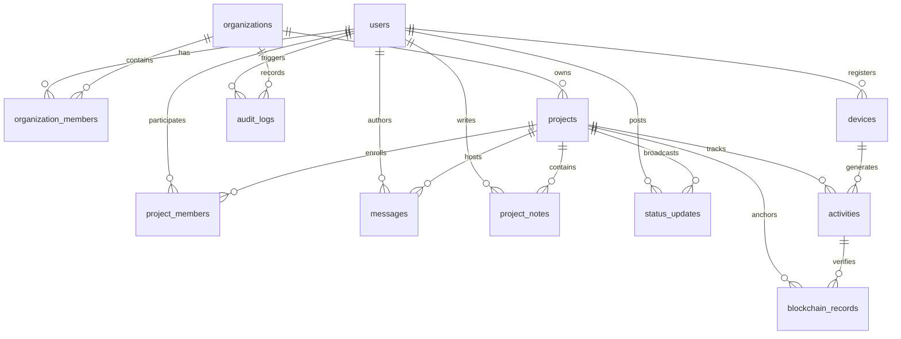

# ProjectPulse Database Architecture & Schema Reference

## 1. Database Overview

ProjectPulse uses **MySQL 8.0+** as its primary relational store. Database schema versioning is managed via **Flyway** migrations located at `backend/src/main/resources/db/migration/`.

- Current Migration: `V1__initial_schema.sql`
- Total Tables: 12
- Foreign Key Constraints: Strict relational integrity with cascading rules where appropriate
- Indexing: Explicit indexes on multi-tenant lookup keys (`organization_id`, `project_id`, `user_id`, `device_id`, timestamps, and hashes)

---

## 2. Entity-Relationship Diagram (ERD)

---

## 3. Table Catalog & Data Dictionary

### 1. `users`
Stores user identities, credentials, and global platform roles.
| Column | Type | Constraints | Description |
|---|---|---|---|
| `id` | VARCHAR(36) | PRIMARY KEY | Unique UUID identifier |
| `email` | VARCHAR(255) | NOT NULL, UNIQUE | User login email |
| `password_hash` | VARCHAR(255) | NOT NULL | BCrypt password hash (cost 12) |
| `full_name` | VARCHAR(255) | NOT NULL | Display name |
| `role` | VARCHAR(50) | NOT NULL | Global role (`PLATFORM_ADMIN`, `USER`) |
| `status` | VARCHAR(50) | NOT NULL | Status (`ACTIVE`, `SUSPENDED`) |
| `created_at` | DATETIME(6) | NOT NULL | Timestamp created |
| `updated_at` | DATETIME(6) | NOT NULL | Timestamp modified |

### 2. `organizations`
Multi-tenant organizational containers.
| Column | Type | Constraints | Description |
|---|---|---|---|
| `id` | VARCHAR(36) | PRIMARY KEY | Unique UUID identifier |
| `name` | VARCHAR(255) | NOT NULL | Display name of organization |
| `slug` | VARCHAR(255) | NOT NULL, UNIQUE | URL-safe slug |
| `description` | TEXT | NULL | Organization mission or notes |
| `created_by` | VARCHAR(36) | NOT NULL, FK -> users(id) | Organization creator |
| `created_at` | DATETIME(6) | NOT NULL | Timestamp created |
| `updated_at` | DATETIME(6) | NOT NULL | Timestamp modified |

### 3. `organization_members`
Association table mapping users to organizations with tenant-scoped roles.
| Column | Type | Constraints | Description |
|---|---|---|---|
| `id` | VARCHAR(36) | PRIMARY KEY | Unique UUID |
| `organization_id` | VARCHAR(36) | NOT NULL, FK -> organizations(id) | Tenant reference |
| `user_id` | VARCHAR(36) | NOT NULL, FK -> users(id) | User reference |
| `role` | VARCHAR(50) | NOT NULL | Tenant role (`ORGANIZATION_OWNER`, `MEMBER`, `VIEWER`) |
| `status` | VARCHAR(50) | NOT NULL | Membership status (`ACTIVE`, `INVITED`, `REMOVED`) |
| `created_at` | DATETIME(6) | NOT NULL | Timestamp joined |
| `updated_at` | DATETIME(6) | NOT NULL | Timestamp updated |

### 4. `projects`
Individual engineering projects under an organization.
| Column | Type | Constraints | Description |
|---|---|---|---|
| `id` | VARCHAR(36) | PRIMARY KEY | Unique UUID |
| `organization_id` | VARCHAR(36) | NOT NULL, FK -> organizations(id) | Parent organization |
| `name` | VARCHAR(255) | NOT NULL | Project name |
| `key_identifier` | VARCHAR(50) | NOT NULL | Short unique project key (e.g., `PRJ-A8F2`) |
| `description` | TEXT | NULL | Project overview |
| `status` | VARCHAR(50) | NOT NULL | Lifecycle (`ACTIVE`, `PAUSED`, `COMPLETED`, `ARCHIVED`) |
| `created_by` | VARCHAR(36) | NOT NULL, FK -> users(id) | Creator user ID |
| `created_at` | DATETIME(6) | NOT NULL | Timestamp created |
| `updated_at` | DATETIME(6) | NOT NULL | Timestamp modified |

### 5. `project_members`
Project-level role assignment.
| Column | Type | Constraints | Description |
|---|---|---|---|
| `id` | VARCHAR(36) | PRIMARY KEY | Unique UUID |
| `project_id` | VARCHAR(36) | NOT NULL, FK -> projects(id) | Project reference |
| `user_id` | VARCHAR(36) | NOT NULL, FK -> users(id) | User reference |
| `role` | VARCHAR(50) | NOT NULL | Project role (`PROJECT_ADMIN`, `MEMBER`, `VIEWER`) |
| `created_at` | DATETIME(6) | NOT NULL | Timestamp joined |

### 6. `devices`
Authorized developer machines running the ProjectPulse Desktop Agent.
| Column | Type | Constraints | Description |
|---|---|---|---|
| `id` | VARCHAR(36) | PRIMARY KEY | Unique UUID |
| `user_id` | VARCHAR(36) | NOT NULL, FK -> users(id) | Owner of machine |
| `device_name` | VARCHAR(255) | NOT NULL | Hostname or machine name |
| `pairing_token` | VARCHAR(255) | NOT NULL, UNIQUE | Cryptographic pairing token |
| `os_info` | VARCHAR(255) | NULL | Operating system details |
| `last_seen_at` | DATETIME(6) | NULL | Heartbeat timestamp |
| `created_at` | DATETIME(6) | NOT NULL | Timestamp created |

### 7. `activities`
Ingested filesystem activity events.
| Column | Type | Constraints | Description |
|---|---|---|---|
| `id` | VARCHAR(36) | PRIMARY KEY | Unique UUID |
| `project_id` | VARCHAR(36) | NOT NULL, FK -> projects(id) | Associated project |
| `device_id` | VARCHAR(36) | NOT NULL, FK -> devices(id) | Originating machine |
| `client_assigned_uuid` | VARCHAR(255) | NOT NULL | Idempotency token from desktop agent |
| `event_type` | VARCHAR(50) | NOT NULL | `FILE_CREATE`, `FILE_MODIFY`, `FILE_DELETE`, `FILE_RENAME` |
| `file_path` | VARCHAR(1000) | NOT NULL | Relative project file path (no sensitive prefixes) |
| `event_count` | INT | NOT NULL | Count of events batched |
| `timestamp` | DATETIME(6) | NOT NULL | Activity occurrence time (UTC) |
| `canonical_hash` | VARCHAR(64) | NOT NULL | SHA-256 digest of canonical activity payload |
| `created_at` | DATETIME(6) | NOT NULL | Ingestion timestamp |

### 8. `messages`
Real-time project collaboration discussion stream.
| Column | Type | Constraints | Description |
|---|---|---|---|
| `id` | VARCHAR(36) | PRIMARY KEY | Unique UUID |
| `project_id` | VARCHAR(36) | NOT NULL, FK -> projects(id) | Project reference |
| `user_id` | VARCHAR(36) | NOT NULL, FK -> users(id) | Author |
| `content` | TEXT | NOT NULL | Message body |
| `created_at` | DATETIME(6) | NOT NULL | Timestamp sent |

### 9. `project_notes`
Structured project documentation and meeting notes, optionally linked to activities.
| Column | Type | Constraints | Description |
|---|---|---|---|
| `id` | VARCHAR(36) | PRIMARY KEY | Unique UUID |
| `project_id` | VARCHAR(36) | NOT NULL, FK -> projects(id) | Project reference |
| `user_id` | VARCHAR(36) | NOT NULL, FK -> users(id) | Author |
| `title` | VARCHAR(255) | NOT NULL | Note title |
| `content` | TEXT | NOT NULL | Note body (Markdown) |
| `activity_id` | VARCHAR(36) | NULL, FK -> activities(id) | Optional linked activity record |
| `created_at` | DATETIME(6) | NOT NULL | Creation timestamp |
| `updated_at` | DATETIME(6) | NOT NULL | Last modified |

### 10. `status_updates`
Standup status updates posted by project members.
| Column | Type | Constraints | Description |
|---|---|---|---|
| `id` | VARCHAR(36) | PRIMARY KEY | Unique UUID |
| `project_id` | VARCHAR(36) | NOT NULL, FK -> projects(id) | Project reference |
| `user_id` | VARCHAR(36) | NOT NULL, FK -> users(id) | Member posting update |
| `status_text` | TEXT | NOT NULL | What was accomplished, next steps, blockers |
| `mood` | VARCHAR(50) | NULL | `ON_TRACK`, `BLOCKED`, `NEED_ASSISTANCE` |
| `created_at` | DATETIME(6) | NOT NULL | Timestamp posted |

### 11. `blockchain_records`
Hyperledger Fabric anchoring audit status for activities.
| Column | Type | Constraints | Description |
|---|---|---|---|
| `id` | VARCHAR(36) | PRIMARY KEY | Unique UUID |
| `activity_id` | VARCHAR(36) | NOT NULL, FK -> activities(id) | Target activity record |
| `project_id` | VARCHAR(36) | NOT NULL, FK -> projects(id) | Scoped project |
| `canonical_hash` | VARCHAR(64) | NOT NULL | SHA-256 hash anchored |
| `transaction_id` | VARCHAR(255) | NULL | Fabric ledger transaction identifier |
| `block_height` | BIGINT | NULL | Blockchain block height |
| `status` | VARCHAR(50) | NOT NULL | `PENDING`, `VERIFIED`, `MISMATCH`, `UNAVAILABLE` |
| `anchored_at` | DATETIME(6) | NULL | Ledger commit timestamp |
| `last_checked_at` | DATETIME(6) | NULL | Last audit verification check |

### 12. `audit_logs`
System-wide audit trail for compliance, security events, and role updates.
| Column | Type | Constraints | Description |
|---|---|---|---|
| `id` | VARCHAR(36) | PRIMARY KEY | Unique UUID |
| `user_id` | VARCHAR(36) | NULL, FK -> users(id) | Actor responsible |
| `organization_id` | VARCHAR(36) | NULL, FK -> organizations(id) | Context organization |
| `action` | VARCHAR(100) | NOT NULL | Action (e.g., `USER_SUSPENDED`, `ROLE_UPDATED`) |
| `entity_type` | VARCHAR(100) | NOT NULL | Entity name (`USER`, `ORGANIZATION`, `PROJECT`) |
| `entity_id` | VARCHAR(36) | NULL | Target entity UUID |
| `details` | TEXT | NULL | JSON or textual audit context |
| `created_at` | DATETIME(6) | NOT NULL | Timestamp occurred |

---

## 4. Multi-Tenant Isolation Strategy

Tenant isolation is enforced strictly at the database query and service layers:
1. Every query for projects, members, activities, messages, and notes requires both `organizationId` and `projectId` validation.
2. In-memory role verification checks that `current_user` belongs to `organization_members` with active status before allowing any resource mutation.
3. Database foreign keys ensure cascading cleanups on test teardown or hard-deletions.
